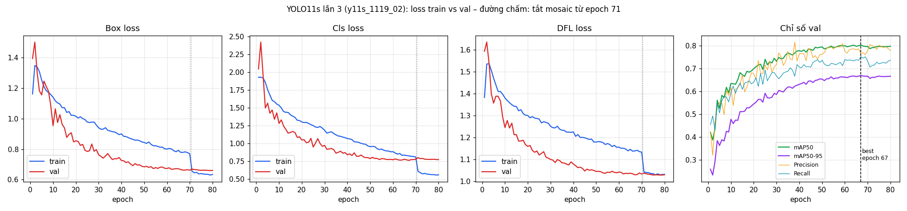
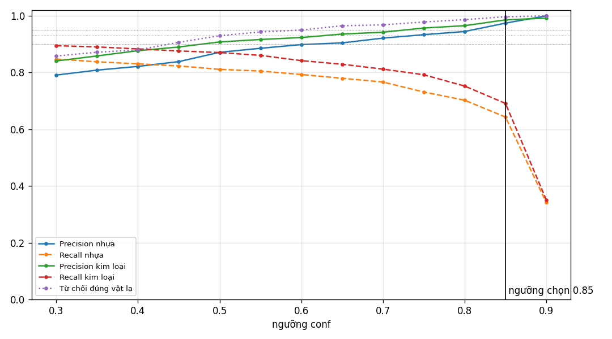

# Báo cáo model AI — ATM Đồng Nát

*Cập nhật 22/11/2026 · model đang dùng: YOLO11s lần 3 (`model/y11s_1119_02`, chép ra `model/best.pt`)*

## 1. Ý tưởng

Trạm thu gom tái chế tự động: người dùng đổ **cả mẻ 10–15 vật** lên khay → khay rung cho vật tách nhau → camera chụp → model khoanh từng vật:

| Nhãn | Gồm | Xử lý |
|---|---|---|
| `plastic` | chai/đồ nhựa thường ngày | tính **200đ**/vật |
| `metal` | lon nhôm, lon thiếc | tính **300đ**/vật |
| `other` | mọi thứ còn lại (thủy tinh, giấy, hộp sữa, túi nilon, đồ ăn...) | **có 1 vật là trả cả mẻ** |

Thêm lớp chặn **so nền khay**: vùng có vật mà model không khoanh → coi là vật lạ → trả mẻ. Người dùng xem ảnh có khung + kết quả, bấm **OK** rồi máy mới đổ vào thùng hoặc trả lại.

## 2. Dữ liệu nguồn (100% công khai, ~10 GB thô — `data/REPORT.md`)

| Nguồn | Ảnh thô | Nội dung | Giấy phép |
|---|---|---|---|
| Kaggle Drinking Waste | 4.811 | 1 vật/ảnh trên nền trơn: lon nhôm, chai PET, chai HDPE, chai thủy tinh; có box | CC0 |
| Kaggle Garbage 12 | 15.515 | 12 lớp rác (pin, giấy, bìa, quần áo, giày, thủy tinh, kim loại, nhựa...) — **chỉ nhãn ảnh, không box** | ODbL |
| Roboflow (2 bộ) | 2.680 | chai nhựa + lon nhôm/thiếc, nhiều vật/ảnh | CC BY 4.0 / PD |
| TACO | 1.500 | rác ngoài trời, 60 lớp (đầu lọc, túi, nắp, ống hút, lon, chai...) | CC BY 4.0 |
| COCO 2017 (phần nhỏ) | 4.256 | đồ vật thường ngày, đã loại ảnh có chai/cốc → làm `other`/nền | CC BY 4.0 |
| Open Images V7 (phần nhỏ) | 8.776 | Bottle, Tin can, 34 lớp đồ vật khác, tay người; **600 ảnh "vật lạ" giữ riêng** để kiểm tra | CC BY 2.0 / 4.0 |

## 3. Xử lý dữ liệu (`scripts/Xu_Ly_Du_Lieu/`, chi tiết `data_da_xu_ly/BAO_CAO.md`)

1. **Chuẩn hóa:** xoay EXIF, ánh xạ ~150 lớp gốc → 3 nhãn theo luật chung (nắp chai, khoen lon, ống hút, thìa dĩa → `other`; nhựa điện tử → `other`).
2. **Khử trùng lặp** bằng pHash; ảnh gần giống, khung cùng video, ảnh zoom + ảnh gốc **chung 1 nhóm** để không rò rỉ giữa train/val/test.
3. **Gán box cho Garbage 12** bằng YOLO-World; **CLIP** quyết chất liệu (nhựa/kim loại/khác); không chắc → người duyệt tay (1.735 ảnh cắt).
4. **Vật quá nhỏ** (< 12 px) bỏ box; tạo ảnh zoom cận cho vật nhỏ.
5. **Cân bằng `other`**, bỏ ảnh mờ/trùng; **chia 70/20/10** theo nhóm, phân tầng theo nhãn và nguồn.
6. **Rà soát sau mỗi lần train** (B11–B15): model + CLIP tìm nhãn nghi sai → người duyệt; bổ sung 2.218 box bị sót; bỏ ảnh cảnh/người; sửa box chồng nhãn; bỏ 134 box `other` nằm trong chai/lon (nắp, khoen) — vì trạm sẽ trả nhầm cả mẻ.
7. **Resize** cạnh dài ≤ 640 px, giữ tỉ lệ (ảnh gốc giữ ở `_ghi_chep/anh_goc_truoc_resize/`).

**Bộ dữ liệu chốt (8.359 ảnh):**

| Tập | Ảnh | plastic | metal | other | Ảnh nền |
|---|---|---|---|---|---|
| train | 5.838 | 2.758 | 2.328 | 3.916 | 29 |
| val | 1.692 | 827 | 703 | 1.056 | 12 |
| test | 829 | 414 | 333 | 597 | 7 |
| **Tổng** | **8.359** | **3.999** | **3.364** | **5.569** | **48** |

Kiểm tra tự động: không ảnh hỏng/thiếu nhãn, box không tràn biên, **0 ảnh gần trùng giữa train và val/test**.

## 4. Train (`scripts/Train/`, cấu hình `scripts/Train/cau_hinh.yaml`)

- **Model:** YOLO11s (9,4 triệu tham số) khởi tạo từ trọng số COCO, RTX 4060 Laptop 8 GB.
- **Tham số:** 80 epoch, imgsz 640, batch 16, optimizer auto, cosine LR, AMP, seed 42.
- **Tăng cường:** mosaic 1.0 (tắt 10 epoch cuối), mixup 0.1, xoay ±5°, lật, scale 0.5, HSV.
- **Thời gian:** 1h57m (~85 s/epoch), VRAM đỉnh 4,9 GB.

| Lần | Dữ liệu | Epoch | val mAP50 | Ghi chú |
|---|---|---|---|---|
| 1 `y11s_1118_01` | 10.416 ảnh, nhãn thô | 113 | 0,753 | recall thấp → rà soát nhãn |
| 2 `y11s_1119_01` | 8.763 ảnh | 100 | 0,786* | |
| **3 `y11s_1119_02`** | **8.359 ảnh** | **80** | **0,802** | **đang dùng** |

\* chấm lại trên val mới để so được với lần 3. Thư mục lần 1, 2 đã xóa (20/11).

### Không bị overfit

- Loss **val giảm đều cùng train** suốt 70 epoch (box 1,39 → 0,66; cls 2,04 → 0,76; dfl 1,59 → 1,03), không có đoạn val tăng ngược.
- Val loss **thấp hơn** train loss phần lớn thời gian vì train chịu tăng cường mạnh (mosaic, mixup) còn val là ảnh gốc.
- mAP val tăng rồi **đi ngang** ở ~0,80 từ epoch 60, không tụt.
- 10 epoch cuối (tắt mosaic): train cls loss giảm mạnh (0,82 → 0,56) nhưng val cls nhích lên nhẹ (0,763 → 0,774) — dấu hiệu bắt đầu học thuộc. Vì vậy **chọn epoch 67** (val tốt nhất) làm `best.pt`, train thêm cũng không có lợi.
- Đồ thị gốc của Ultralytics: `model/y11s_1119_02/results.png`, ma trận nhầm lẫn `confusion_matrix*.png`, đường PR `BoxPR_curve.png`.

## 5. Kết quả (tập val 1.692 ảnh, `best.pt`)

Detection không đo "accuracy" như phân loại mà đo **mAP, Precision (đã báo thì đúng bao nhiêu), Recall (bắt được bao nhiêu)**.

| Chỉ số | Kết quả | Mục tiêu |
|---|---|---|
| mAP50 / mAP50-95 | **0,802** / 0,669 | ≥ 0,85 ❌ |
| AP50 nhựa / kim loại / other | 0,902 / 0,932 / 0,573 | |
| Precision nhựa / kim loại (ngưỡng 0,85) | **0,974 / 0,986** | ≥ 0,95 ✅ |
| Recall nhựa / kim loại (ngưỡng 0,85) | 0,643 / 0,691 | ≥ 0,93 ❌ |
| Từ chối vật lạ chưa từng thấy (600 ảnh) | **99,7%** | ≥ 90% ✅ |
| Tốc độ | GPU 114 FPS, CPU 17,5 FPS | ≥ 20 ✅ |

- **Đánh đổi ngưỡng:** 0,85 hầu như không báo nhầm nhưng sót ~1/3 chai/lon; 0,50 bắt ~81–87% nhưng precision còn 0,87–0,91.
- **Theo nguồn:** ảnh cận cảnh 1 vật (Drinking Waste) gần hoàn hảo (recall nhựa 0,98, kim loại 0,91); ảnh nhiều vật / ngoài trời (TACO, Open Images) recall thấp (0,16–0,24) → model yếu khi vật nhỏ, nhiều vật, nền rối.
- **Nhầm lẫn giữa 3 lớp gần như không có** (nhựa ↔ kim loại 1–2 vật); lỗi chính là **bỏ sót**.
- Tập **test chưa dùng** — để dành chấm 1 lần cho model cuối.

## 6. Tích hợp vào trạm mô phỏng 3D (22/11)

- `app/detection/yolo_detector.py` (ngưỡng 0,85 / 0,80, imgsz 1280 vì cả khay nằm trong 1 khung), `app/detection/background.py` (so nền khay), màn xác nhận ảnh + nút OK (`WAITING_CONFIRM`).
- Vật 3D phủ **ảnh thật** cắt từ tập train, tách nền bằng GrabCut (`tools/tao_anh_that_3d.py`).
- Panel Dev (phím `~`) đổi giữa **model thật** và **giả lập theo đáp án 3D**; `.env DETECTOR=mock` mặc định.
- **Phát hiện quan trọng:** mô phỏng 30 mẻ × 6 vật → nhận đúng từng vật ~10% (ngưỡng 0,85) / ~35% (0,5) → **mẻ sạch gần như luôn bị trả**. Ngay cả trên ảnh thật, recall ~0,65/vật → xác suất bắt đủ 12/12 vật ≈ 1%. Luật "sót 1 vật là trả cả mẻ" chưa dùng được với model hiện tại.

## 7. Hạn chế & bước tiếp

1. **Dữ liệu chưa giống trạm:** 77% ảnh chỉ có 1 vật, chỉ 48 ảnh nền, không có ảnh khay thật → cần **chụp ảnh khay thật** (10–15 vật/mẻ, mẻ sạch + mẻ lẫn rác) để train thêm và chọn ngưỡng.
2. **Lớp `other` yếu** (AP50 0,573): rác đa dạng vô hạn; dựa thêm vào so nền khay + luật trả mẻ.
3. Xem lại luật trạm (nới so nền, hoặc chỉ không tính tiền vật không chắc) khi có số liệu khay thật.
4. Chấm tập test 1 lần khi chốt model cuối; xuất `model/best.onnx` đã có sẵn cho triển khai.

**File liên quan:** `data/REPORT.md` (dữ liệu thô) · `data_da_xu_ly/BAO_CAO.md` (xử lý) · `model/MODEL_CARD.md` · `model/y11s_1119_02/danh_gia/BAO_CAO_TRAIN.md` (đánh giá đầy đủ) · `../plan_train.md` (nhật ký quyết định).
